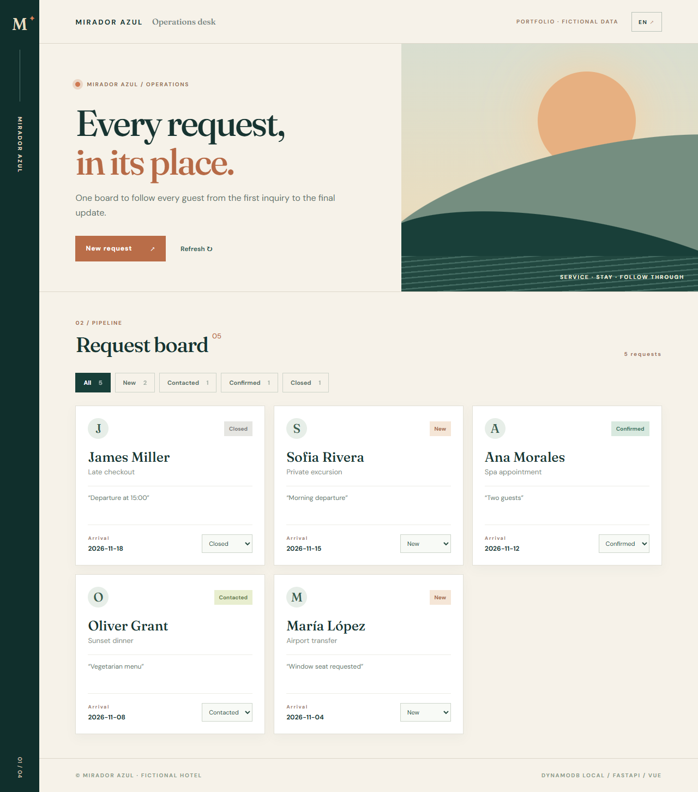

# Mirador Azul · Hotel Operations Desk

An independent **portfolio demo** for a fictional hotel. FastAPI exposes a request workflow backed by **real DynamoDB Local**; Vue 3 provides a bilingual operations board. No production hotel, AWS account, guest data or paid service is involved.



The screenshots also include [Spanish](docs/screenshots/operations-desk-es.png) and [mobile](docs/screenshots/operations-desk-mobile.png) views.

## What works

- Create a test guest request and move it through `new → contacted → confirmed → closed`.
- Query a hotel's requests by composite key and query status through the `hotel-status-created` global secondary index. No table scan is used for the board's status filter.
- Prevent stale updates using DynamoDB conditional expressions and a version counter. Concurrent edits return HTTP 409.
- Validate names, services, dates and notes through FastAPI/Pydantic. The interface is available in Spanish and English.
- Run an idempotent fictional seed and an API test against DynamoDB Local.

## Requirements and setup (Windows PowerShell)

Python 3.10+, Node 20+, Java 17+, and an internet connection for the first dependency and DynamoDB Local download. Docker and AWS credentials are **not** required. [AWS documents DynamoDB Local as a free local development tool](https://docs.aws.amazon.com/amazondynamodb/latest/developerguide/DynamoDBLocal.DownloadingAndRunning.html).

```powershell
cd C:\Proyectos\YuJu\Code\hotel-ops-dynamodb-demo
python -m venv .venv
.\.venv\Scripts\python -m pip install -r requirements.txt
New-Item -ItemType Directory -Force .local | Out-Null
Invoke-WebRequest https://d1ni2b6xgvw0s0.cloudfront.net/v3.x/dynamodb_local_latest.zip -OutFile .local\DynamoDBLocal.zip
Invoke-WebRequest https://d1ni2b6xgvw0s0.cloudfront.net/v3.x/dynamodb_local_latest.zip.sha256 -OutFile .local\DynamoDBLocal.zip.sha256
# Compare the published checksum to: (Get-FileHash .local\DynamoDBLocal.zip -Algorithm SHA256).Hash
Expand-Archive .local\DynamoDBLocal.zip .local\dynamodb -Force
```

Open **three terminals**:

```powershell
# Terminal 1: DynamoDB Local
cd C:\Proyectos\YuJu\Code\hotel-ops-dynamodb-demo\.local\dynamodb
java "-Djava.library.path=./DynamoDBLocal_lib" -jar DynamoDBLocal.jar -sharedDb -port 8008
```

```powershell
# Terminal 2: API (from project root)
.\.venv\Scripts\python -m api.seed
.\.venv\Scripts\python -m uvicorn api.main:app --host 127.0.0.1 --port 8088
```

```powershell
# Terminal 3: Vue
cd frontend
npm install
npm run dev
```

Open <http://127.0.0.1:5178>. API docs: <http://127.0.0.1:8088/docs>. Local DynamoDB's credentials in this code are dummy identifiers accepted by DynamoDB Local; never substitute real AWS keys for this demo.

## Verification

With DynamoDB Local running:

```powershell
.\.venv\Scripts\python -m pytest -q
cd frontend
npm run build
```

The test creates and updates a fictional request, checks the status index, rejects a stale version, and rejects an impossible date. The UI displays the data from DynamoDB Local, not a hardcoded mock. The test leaves only fictional data in the ignored local database.

## Evidence boundary

This proves local hands-on **Vue 3, FastAPI and DynamoDB API** use. It does **not** establish production DynamoDB operation, AWS deployment, live hotel usage, or performance at scale. The existing Mirador Azul Voice Concierge repository separately shows Twilio-compatible signed webhooks and a simulator; a real Twilio trial call has not been verified.
